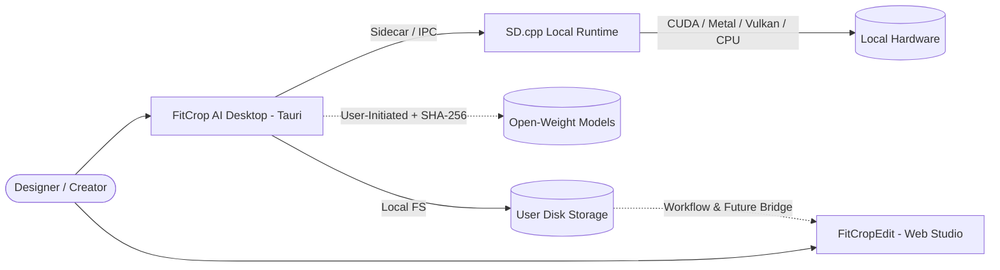

# FitCrop Platform

> **Local-first AI image generation meets fast browser-based design editing.**

Welcome to the official community, documentation, and architecture hub for the **FitCrop** ecosystem. While the core application source code is private, this repository serves as the central place for releases, hardware compatibility, prompt guides, bug reports, and system design documentation.

---

## Ecosystem Overview

### 1. FitCrop AI (Native Desktop App)
A standalone, privacy-first desktop application built with **Tauri** and powered locally by **SD.cpp**.
- **On-Device Inference:** Generate images directly on your GPU/CPU (CUDA, Vulkan, Metal, or CPU) without sending prompts or outputs to cloud servers.
- **Verified Model Management:** Download open-weight diffusion models, VAE, and CLIP packages with local SHA-256 integrity verification.
- **Hardware Diagnostics:** Built-in checks for VRAM, GPU backend compatibility, and system readiness.

### 2. FitCropEdit (Web-Based Studio)
A fast, lightweight browser-based image editor available at **[fitcropedit.com](https://fitcropedit.com/)**.
- Built for designers and creators to crop, retouch, adjust, and prepare visuals for work, social media, and print.
- *Upcoming:* Seamless workflow bridge between local **FitCrop AI** generation and **FitCropEdit** finishing tools.

---

## High-Level Architecture

### Core Engineering Principles
- **Zero-Telemetry Privacy:** Prompts, seeds, workflows, and generated images never leave the user's machine.
- **Software Tool Neutrality:** Users voluntarily select, review, and run third-party open-weight models on their own hardware.
- **Cross-Platform Efficiency:** Lightweight native Rust/WebView shell via Tauri instead of heavy browser-bundled runtimes.

---

## Quick Navigation

| Resource | Description | Link |
| :--- | :--- | :--- |
| **Bug Reports** | Found an issue in FitCrop AI or FitCropEdit? | [Open an Issue](https://github.com/ya6/fitcrop-platform/issues/new/choose) |
| **Community & Prompts** | Share prompts, GPU benchmarks, and ideas | [Join Discussions](https://github.com/ya6/fitcrop-platform/discussions) |
| **Web Studio** | Launch the browser-based image editor | [fitcropedit.com](https://fitcropedit.com/) |
| **Releases** | Installers & SHA-256 checksums *(coming soon)* | [View Releases](https://github.com/ya6/fitcrop-platform/releases) |

---

## Feedback & Support

If you encounter a crash, GPU/VRAM issue, or unexpected behavior:
1. Check [Discussions](https://github.com/ya6/fitcrop-platform/discussions) for known hardware tips or model settings.
2. Submit a structured [Bug Report](https://github.com/ya6/fitcrop-platform/issues/new/choose) with your OS, GPU/VRAM specs, model name, and error output.

---

*Note: FitCrop AI and FitCropEdit are proprietary products. This repository hosts public documentation, release artifacts, and community feedback.*
