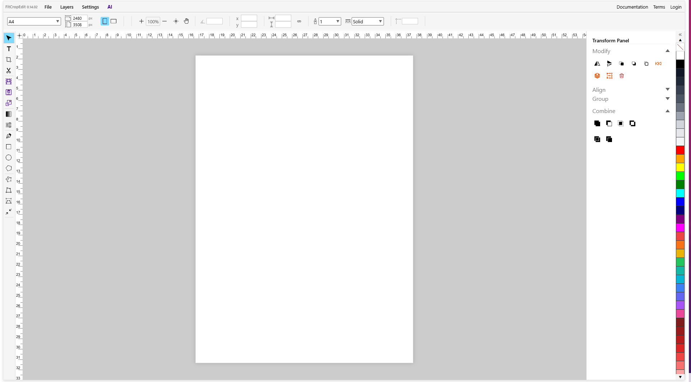
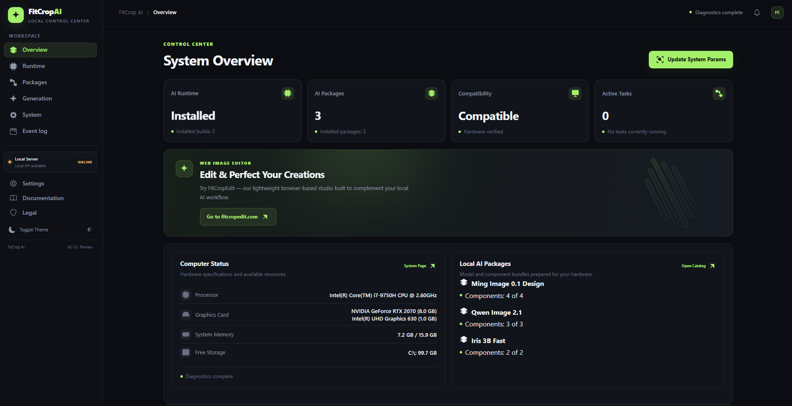
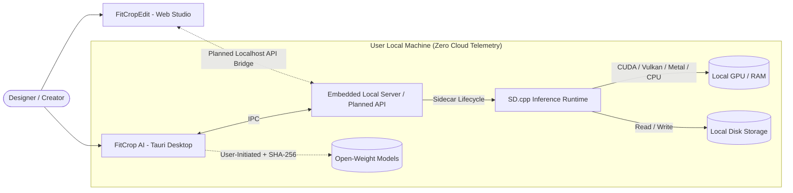

# FitCrop Platform

> **Fast browser-based design studio paired with a private, local-first AI companion.**

Welcome to the official documentation, architecture, and community hub for the **FitCrop** ecosystem. While the core application source code is private, this repository serves as the central hub for user guides, hardware compatibility, release artifacts, system architecture, and community feedback.

---

## 1. FitCropEdit (Web-Based Studio)

**[FitCropEdit](https://fitcropedit.com/)** is a fast, lightweight browser-based image editor designed for creators, designers, and everyday visual workflows — from quick cropping and retouching to preparing assets for web, social media, and print.

<!-- IMAGE SLOT: Upload assets/fitcrop-edit-preview.png and remove comment tags below

  

-->

### Key Entry Points
- 🎨 **Launch Web Studio:** [fitcropedit.com](https://fitcropedit.com/)
- 📐 **Workflow & Guides:** [FitCropEdit Documentation](./docs/fitcrop-edit/) *(workflows & AI-to-design guides — coming soon)*
- 🗓️ **Upcoming Features:** [Ecosystem Roadmap](./ROADMAP.md)

---

## 2. FitCrop AI (Native Desktop App & Local AI Companion)

**FitCrop AI** is a standalone, privacy-first desktop application built with **Tauri v2** and powered locally by **SD.cpp**.

Today, it runs independently on your machine for offline image generation with zero cloud costs or telemetry. Under the hood, it also runs an **embedded local server** designed to evolve into a **Local API Companion** — allowing **FitCropEdit** in your browser to tap directly into your own GPU for generation, variations, and finishing workflows without uploading private assets to external AI clouds.

<!-- IMAGE SLOT: Upload assets/fitcrop-ai-preview.png and remove comment tags below

  

-->

### Key Entry Points
- 📚 **FitCrop AI Docs Hub:** [Engine, Models, Quantization & Prompting](./docs/fitcrop-ai/)
- 🖥️ **Hardware & GPU Guide:** [CUDA, Vulkan, Metal, CPU & VRAM Tiers](./docs/fitcrop-ai/hardware-and-gpu.md)
- 📦 **Downloads & Checksums:** [GitHub Releases](https://github.com/ya6/fitcrop-platform/releases) *(installers & SHA-256 — coming soon)*

---

## 3. Ecosystem Architecture & Knowledge Base

Deep-dive documentation covering how the web studio, local server bridge, and C++ inference runtime work together — plus foundational guides on local AI concepts.

### Engineering & Reference Links
- 🏗️ **System Design:** [System Architecture Overview](./docs/architecture/system-overview.md) — Tauri v2 vs Electron, `SD.cpp` sidecar isolation, security boundaries, and the Local API direction.
- 🗺️ **Product Strategy:** [FitCrop Ecosystem Roadmap](./ROADMAP.md) — Current milestones from `v1.0` hardening to `v1.1+` Desktop ↔ Web integration.

---

## 4. Bug Reports, Feedback & Discussions

Found an issue or want to share prompts and GPU benchmarks? Use the dedicated links below:

| Channel | Purpose | Action |
| :--- | :--- | :--- |
| **FitCropEdit Bug Report** | Canvas, export, UI glitches, or browser issues on `fitcropedit.com` | [Report Web Studio Bug](https://github.com/ya6/fitcrop-platform/issues/new?template=02_bug_fitcrop_edit.yml) |
| **FitCrop AI Bug Report** | Crashes, GPU/VRAM errors, model downloads, or `SD.cpp` issues | [Report Desktop AI Bug](https://github.com/ya6/fitcrop-platform/issues/new?template=01_bug_fitcrop_ai.yml) |
| **Community & Prompts** | Prompt recipes, quantization tips, GPU benchmarks & feature ideas | [Open Discussions](https://github.com/ya6/fitcrop-platform/discussions) |

---

*Note: FitCropEdit and FitCrop AI are proprietary products. This repository hosts public documentation, architectural overviews, release artifacts, and community feedback.*
