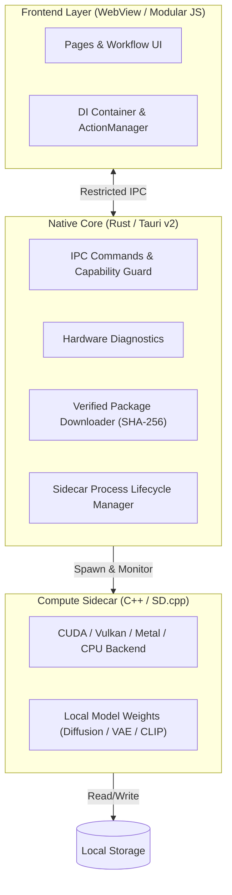

# FitCrop System Architecture Overview

This document outlines the high-level architecture, key engineering trade-offs, and security boundaries of the **FitCrop** ecosystem (**FitCrop AI** + **FitCropEdit**).

---

## 1. Design Goals

1. **Zero-Friction Local AI Execution:** Eliminate Python virtual environments, dependency conflicts, and manual CLI setup for end users.
2. **Strict Data Sovereignty:** Keep all user prompts, workflows, and generated images on local hardware with zero cloud telemetry.
3. **Predictable Cross-Platform Footprint:** Keep the desktop installer lightweight while maximizing available RAM/VRAM for neural network inference.
4. **Complementary Web Ecosystem:** Pair local heavy compute (image generation) with instant browser-based finishing (**FitCropEdit**).

---

## 2. Desktop Runtime Architecture (FitCrop AI)

FitCrop AI uses a decoupled three-layer architecture built on **Tauri v2**:

### Key Engineering Decisions (ADRs)

#### Why Tauri v2 instead of Electron?
- **Resource Overhead:** AI image generation consumes significant system RAM and VRAM. Tauri leverages the OS-native WebView (WebView2 / WebKit) and a compiled Rust core, avoiding an extra Chromium instance competing for memory.
- **Security Model:** Tauri v2 capabilities allow strict, fine-grained scoping for filesystem access, process execution, and external URL opening.

#### Why `SD.cpp` instead of bundled Python + PyTorch?
- **Distribution Simplicity:** Bundling Python, `torch`, and CUDA wheels produces multi-gigabyte installers and brittle runtime environments across Windows/macOS/Linux.
- **Native Performance:** `SD.cpp` (GGML-based C++ inference) compiles into compact, self-contained binaries with hardware-specific acceleration (CUDA, Vulkan, Metal, AVX/CPU) and clean process isolation.
- **Fault Isolation:** Running inference in a managed child process guarantees that an Out-of-VRAM crash in the neural runtime cannot corrupt the main UI shell.

#### Integrity & Supply Chain Safety
- Model packages and runtime binaries are downloaded only upon explicit user action.
- Every downloaded artifact undergoes local **SHA-256 checksum verification** before being registered for execution.

---

## 3. Ecosystem Integration Direction (Desktop ↔ Web)

**FitCropEdit** (`https://fitcropedit.com/`) runs entirely in the browser for fast cropping, retouching, and design preparation without requiring local installation.

As the ecosystem evolves (`v1.1+`), the architecture will support a **local-first handoff bridge**:
- Generated outputs remain stored locally on the user's machine.
- Users can explicitly initiate an *"Open in FitCropEdit"* workflow to transfer selected assets directly into the web editor without uploading private generation histories or prompts to third-party servers.
